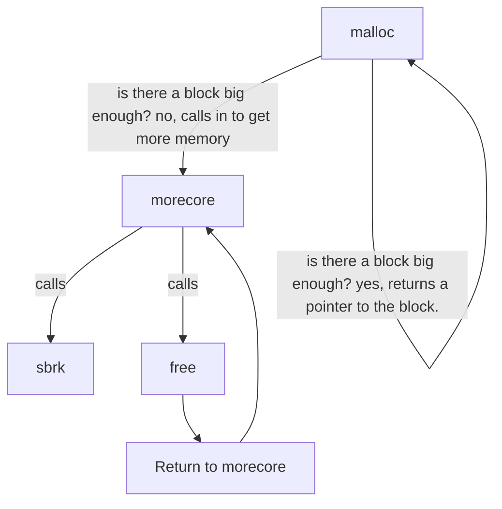

# memory management

One of the things that makes memory management so interesting is that to the user, `malloc` allows the developer to think of memory as fully linear blocks that they can do whatever they desire. They can abastract the concept into whatever metaphor they like: a library, a clean set of bins on a large shelf, a filing cabinet, ect.

In reality the developer is interacting with fragmented (scattered) non linear blocks inside of the heap portion of virtual memory provided by the computer OS. The primary job of a memory manager is to cleanly manage scattered memory blocks and maintain an ordered relationship for the user.

`malloc()` takes on the job of creating order from chaos (simply put, it organizes fragmented virtual memory). It also provides a clean api that reduces memory management risks, while under the hood `malloc()` uses the system level utility `sbrk()` to request more heap from the OS. With this system the user can get as much memory as they need when they need more of it.

This post takes a look at the malloc implementation from the famous C language book: The C Programming Language by Brian Kernighan and Dennis Ritchie. They have a minimal implementation of malloc that spans a small number of lines which makes it much easier to digest than looking at the [full GNU C implementation of malloc](https://github.com/bminor/glibc/blob/master/malloc/malloc.c).

## malloc

Malloc manages memory, loops through free memory and matches free memory blocks with the requested size.

Malloc initializes blocks into a linked list of memory units. Each node looks like this:

```c
union header {
    struct {
        union header *next;
        unsigned size
    } s;
    long align;
}

typedef union header Header;
```

On the first call to `malloc`, a free list is created as a single base node.

This single node - 'free list' - is then subdivided based on the user's request (the size argument in malloc). The block of the requested size is then returned to the user.

On subsequent calls to `malloc` the free list becomes fragmented through this process of carving up larger blocks into smaller blocks.

When more memory is needed from the system `malloc` will request it from the system and add it to the free list.

When blocks of memory are freed, `malloc` will defragment the list by joining the freed blocks back into the list.

## call chain

Under the hood `malloc` uses three core functions:

- `morecore` - allocates memory blocks for malloc. Calls `sbrk` under the hood (a system call for setting the available heap memory for the process).
- `free` - frees memory allocated by malloc, _maintains the circular relationship of the free list_ (more on this later).
- `sbrk` - is a unix os system call that sets the amount of memory available to a process (the heap). It returns a contigous block of virtual memory.

On first call `malloc` allocates memory by calling `morecore` which unconditionally calls two important functions: `sbrk` and `free`. That's right, `free` is part of the secret sauce of `malloc`, it's called whenever more memory is needed. Most importantly this happens on the first call of `malloc`.

The initial call to `malloc` calls `morecore` which in turn calls `free`. This setup does some important things:

2. establishes pointer relationships between nodes. malloc tracks the current node, next node, previous node, and the base node (start of the free list).
3. allocates memory from the system
4. establishes the free list



<!-- ## Global variables

Starting header units for the list as `base` and `freep` are created as global variables so they can be accessed by the full `malloc` call stack:

```c
static Header base; /* empty list to get started */
static Header *freep = NULL; /* the start of the free list */
```

In malloc itself there are several initializations for the linked list:

`current node`
`previous node`
`current free node` -->

## free

Free is called by the user when they need to manually free a block that's been allocated. But, it's also called internally when `morecore` is called.

## Speed, I want speed. Performance Notes

> "I want the good stuff. Give me that L1"

When considering that `malloc` works directly with _virtual memory_ only you may wonder, _is malloc inherently slow?_, (because it's just pushing around virtual memory)? _"What if I want to structure my application to really take advantage of memory hierarchy and locality?"_ You might think _"I want the good stuff, give me the high performance cache, the registers, I want what's closest to the CPU."_ The table below shows you the difference between memory access cycles:

| memory location | cpu cycles  |
| --------------- | ----------- |
| CPU Registers   | ~1          |
| L1/L2/L3 Cache  | ~1 - 10s    |
| Main Ram        | ~100s       |
| HD Storage      | ~1,000,000s |

The table above seems to tell a compelling story and usher the developer toward those lower registers. The reality is, that the computer architecture manages which kind of memory is utilized. Malloc works directly with virtual memory, which should not give the impression that it's slow.

Virtual memory is an addressing scheme that maps contiguous virual locations to physical RAM. RAM is not slow, it's fast! malloc'd memory is in RAM = fast.
