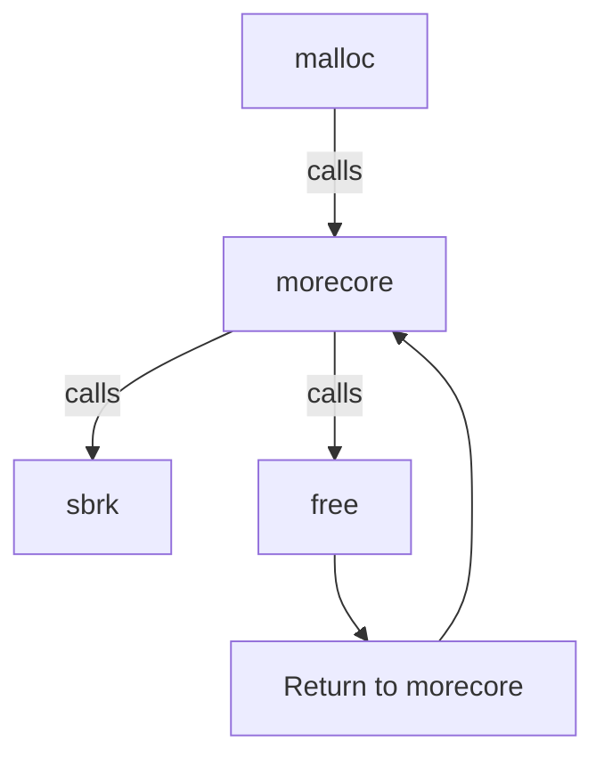

# memory management

One of the things that makes memory management so interesting is that operating systems use and provide developers access to memory, but in the form of scattered non linear blocks. One of the primary jobs of a memory manager is to take in the scattered memory blocks and maintain an ordered relationship for the user.

## malloc

Malloc initializes a linked list of memory units.

Each node looks like this:

```c
union header {
    struct {
        union header *ptr;
        unsigned size
    } s;
    long align;
}

typedef union header Header;
```

## call chain

When `malloc` is called it allocates memory by calling `morecore` which unconditionally calls two important functions: `sbrk` and `free`

- `malloc` - manages memory, loops through free memory and matches free memory blocks with the requested size
- `morecore` - allocates memory blocks for malloc. Calls `sbrk` under the hood (a system call for setting the available heap memory for the process).
- `free` - frees memory allocated by malloc, _maintains the circular relationship of the free list_ (more on this later).
- `sbrk` - is a unix os system call that sets the amount of memory available to a process (the heap). It returns a contigous block of virtual memory.



## malloc

Starting header units for the list as `base` and `freep` are created as global variables:

```c
static Header base;
static Header *freep = NULL;
```

In malloc itself there are several initializations for the linked list:

`current node`
`previous node`
`current free node`

# free

Free is called by the user when they need to manually free a block that's been allocated. But, it's also called internally when `morecore` is called
