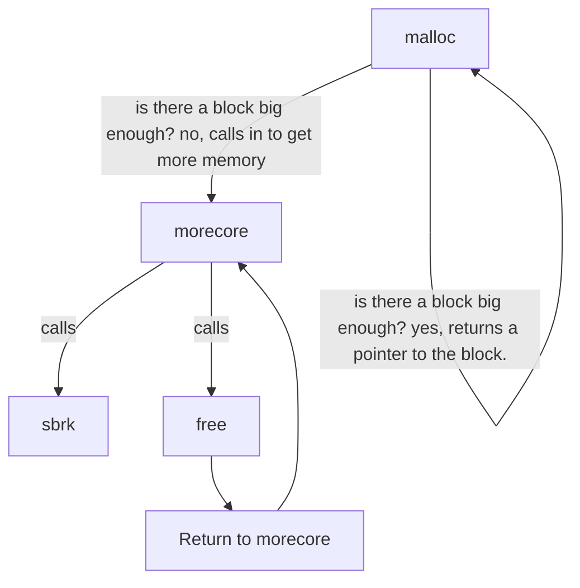
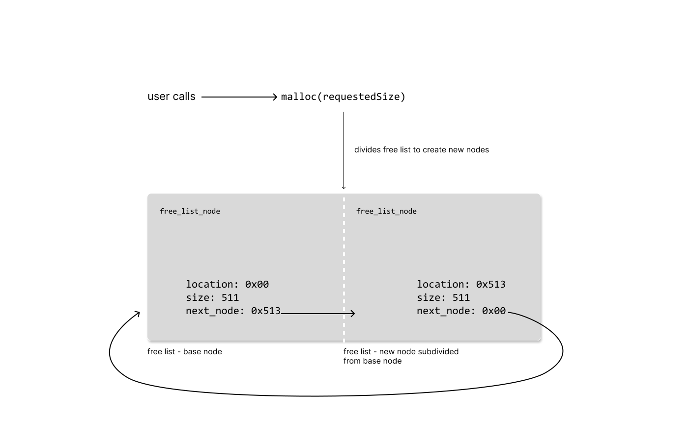
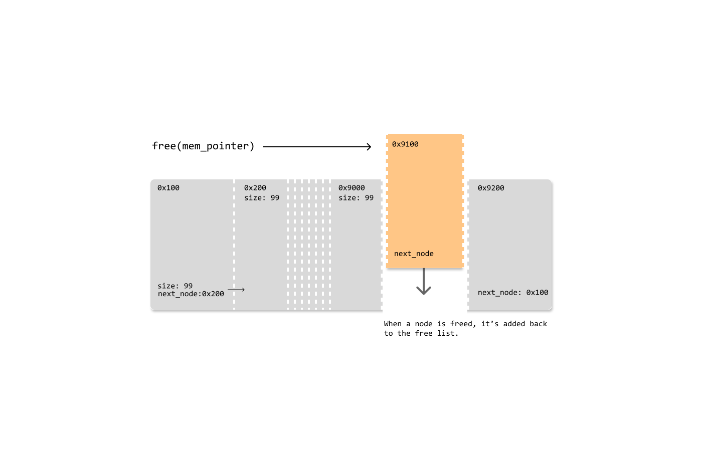
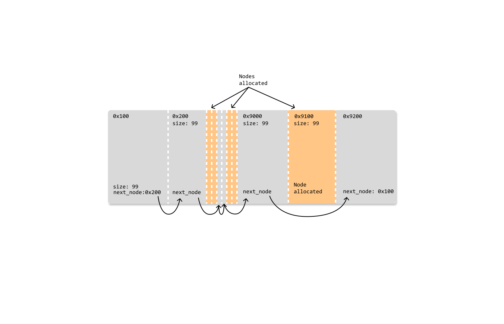

# memory management

One of the things that makes memory management so interesting is that to the user, `malloc` allows the developer to think of memory as fully linear blocks that they can do with whatever they desire. They can abastract the concept into whatever metaphor they like: a library, a clean set of bins on a large shelf, a filing cabinet, a group of nodes ect. It's relatively easy to visualize.

In reality the developer is interacting with fragmented (scattered) non linear blocks inside of the heap portion of virtual memory provided by the computer OS. The primary job of a memory manager is to cleanly manage scattered memory blocks and maintain an ordered relationship for the user.

`malloc()` takes on the job of creating order from chaos by organizing fragmented virtual memory. It also provides a clean api that reduces memory management risks, while under the hood `malloc()` uses the system level utility `sbrk()` to request more heap from the OS. The malloc system, which include a nested chain of functions, lets the user get as much memory as they need whenever they need more of it.

This post takes a look at the malloc implementation from the famous C language book: The C Programming Language by Brian Kernighan and Dennis Ritchie. They have a minimal implementation of malloc that spans a small number of lines which makes it much easier to digest than looking at the [full GNU C implementation of malloc](https://github.com/bminor/glibc/blob/master/malloc/malloc.c).

## malloc

Malloc manages memory, loops through free memory and matches free memory blocks with the requested size.

Malloc initializes blocks into a linked list of memory units. References to the memory blocks are returned to the user.

When the user is finished with the block they return them to malloc with `free()`, which incorporates them back into the list.

## From a very high level - call chain

`malloc` uses three core functions:

- `morecore` - allocates memory blocks for malloc. Calls `sbrk` under the hood (a system call for setting the available heap memory for the process).
- `free` - frees memory allocated by malloc, _maintains the circular relationship of the free list_ (more on this later).
- `sbrk` - is a unix os system call that sets the amount of memory available to a process (the heap). It returns a contigous block of virtual memory.

On first call, `malloc` allocates memory by calling `morecore` which unconditionally calls two important functions: `sbrk` and `free`. That's right, `free` is part of the secret sauce of `malloc`, it's called whenever more memory is needed. Most importantly this happens on the first call of `malloc`. This setup does some important things:

1. establishes pointer relationships between nodes. malloc tracks the current node, next node, previous node, and the base node (start of the free list).
2. allocates memory from the system
3. establishes the free list

### The call sequence:



### Let's visualize what malloc looks like from a high level


_On the first call to `malloc`, a free list is created as a single base node._

```c
union header {
    struct {
        union header *next;
        unsigned size
    } s;
    long align;
}

typedef union header Header;

// global variables
Header base;
Header *freep = NULL;
```

You are may be wondering what the "align" member in Header is for. Memory alignment is esentially the spacing of data in memory. Adding a field to the struct for alignment ensures that the data will be spaced evenly (every 8 bytes). The system call to `sbrk()` is somewhat insidious, in that it does not guarentee aligned memory. Forcing alignment in the struct acts as a compiler optimization that helps `malloc` organize the free list in memory.

```c
void malloc(unsigned n_bytes) {
    Header *cur_p, *prev_p;

    ...

    prev_p = freep; // assign prev node to the current freep
    if (prev_p == NULL) { // if prev_p is null, it's the first call to malloc
        base.s.next = freep = prev_p = &base; // set all variables to the base
        base.s.size                  = 0;
    }

    ...
```

---



_This single node - 'free list' - is then subdivided based on the user's request (the size argument in malloc). The block of the requested size is then returned to the user._

---


_On subsequent calls to `malloc` the free list becomes fragmented through this process of carving up larger blocks into smaller blocks._

---


_When more memory is needed from the system `malloc` will request it from the system and add it to the free list._

---



_Over time as more memory is needed and more memory is freed the list will become fragmented. To combat fragmentation newly freed nodes are merged into adjacent nodes_

---



_It's important to note, that when discussing nodes that are added and removed from the free list, they are not pushed and popped like nodes in an array/vector/ect. They are bypassed through pointer arithmetic._

---


_When blocks of memory are freed, `malloc` will defragment the list by joining the freed blocks back into the list._

---

## Pointer relationships the true secret sauce of malloc

By now, you understand from a high level how malloc works. The most tricky aspect of the process is maintaining the pointer relationships between the headers.

## free

Free is called by the user when they need to manually free a block that's been allocated. But, it's also called internally when `morecore` is called.

## Speed, I want speed. Performance Notes

> "I want the good stuff. Give me that L1"

When considering that `malloc` works directly with _virtual memory_ only you may wonder, _is malloc inherently slow?_, (because it's just pushing around virtual memory)? _"What if I want to structure my application to really take advantage of memory hierarchy and locality?"_ You might think _"I want the good stuff, give me the high performance cache, the registers, I want what's closest to the CPU."_ The table below shows you the difference between memory access cycles:

| memory location | cpu cycles  |
| --------------- | ----------- |
| CPU Registers   | ~1          |
| L1/L2/L3 Cache  | ~1 - 10s    |
| Main Ram        | ~100s       |
| HD Storage      | ~1,000,000s |

The table above seems to tell a compelling story and usher the developer toward those lower registers. The reality is, that the computer architecture manages which kind of memory is utilized. Malloc works directly with virtual memory, which should not give the impression that it's slow.

Virtual memory is an addressing scheme that maps contiguous virual locations to physical RAM. RAM is not slow, it's fast! malloc'd memory is in RAM = fast.
